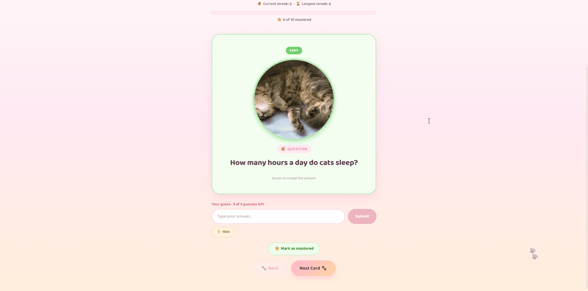

# Web Development Project 3 - *Cat Facts*

Submitted by: **Scarlet Ceballos**

This web app: **A cat trivia flashcard game. Users type a guess for each question, get instant correct/incorrect feedback, flip the card to see the answer, and move through an ordered (or shuffled) deck while tracking streaks, accuracy, and mastered cards.**

Time spent: **9** hours spent in total

## Required Features

The following **required** functionality is completed:

- [x] **The user can enter their guess into an input box *before* seeing the flipside of the card**
  - Application features a clearly labeled input box with a submit button where users can type in a guess
  - Clicking on the submit button with an **incorrect** answer shows visual feedback that it is wrong 
  -  Clicking on the submit button with a **correct** answer shows visual feedback that it is correct
- [x] **The user can navigate through an ordered list of cardss**
  - A forward/next button displayed on the card navigates to the next card in a set sequence when clicked
  - A previous/back button displayed on the card returns to the previous card in the set sequence when clicked
  - Both the next and back buttons should have some visual indication that the user is at the beginning or end of the list (for example, graying out and no longer being available to click), not allowing for wrap-around navigation

The following **optional** features are implemented:

- [x] Users can use a shuffle button to randomize the order of the cards
  - Cards should remain in the same sequence (**NOT** randomized) unless the shuffle button is clicked 
  - Cards should change to a random sequence once the shuffle button is clicked
- [x] A user’s answer may be counted as correct even when it is slightly different from the target answer
  - Answers are considered correct even if they only partially match the answer on the card 
  - Examples: ignoring uppercase/lowercase discrepancies, ignoring punctuation discrepancies, matching only for a particular part of the answer rather than the whole answer
- [x] A counter displays the user’s current and longest streak of correct responses
  - The current counter increments when a user guesses an answer correctly
  - The current counter resets to 0 when a user guesses an answer incorrectly
  - A separate counter tracks the longest streak, updating if the value of the current streak counter exceeds the value of the longest streak counter 
- [x] A user can mark a card that they have mastered and have it removed from the pool of displayed cards
  - The user can mark a card to indicate that it has been mastered
  - Mastered cards are removed from the pool of displayed cards and added to a list of mastered cards

The following **additional** features are implemented:

- [x] **Hint button** that reveals the first letter and length of a key answer word without flipping the card
- [x] **Mastery progress bar and guess accuracy**, showing how many cards are mastered and the percentage of guesses that were correct
- [x] Difficulty filter (Easy / Medium / Hard) with color-coded cards
- [x] Card flip animation and swipe transitions between cards
- [x] Keyboard shortcuts: left/right arrows to navigate, Space/Enter to flip (disabled while typing in the guess box)
- [x] Mastered cards can be restored back into the deck

## Video Walkthrough

Here's a walkthrough of implemented required features:

<!-- Replace this with whatever GIF tool you used! -->
GIF created with [N-Studio](https://nicke.tech/n-studio) for Windows

## Images Used: 
- https://commons.wikimedia.org/wiki/File:Cat_loves_sweets.jpg
- https://pixnio.com/free-images/2017/07/06/2017-07-06-07-22-29.jpg
- https://upload.wikimedia.org/wikipedia/commons/5/52/Cats_in_aoshima_island_1.JPG
- https://upload.wikimedia.org/wikipedia/commons/3/3d/Scottish-Fold-Cat.jpg
- https://commons.wikimedia.org/wiki/File:Black_cat_sniffing_a_flower.jpg
- https://picryl.com/media/cat-kitten-red-mackerel-tabby-animals-5c9ad9
- https://www.flickr.com/photos/helenzhang/3471300822
- https://commons.wikimedia.org/wiki/File:Red_Kitten_01.jpg
- https://pxhere.com/en/photo/995320
- https://www.flickr.com/photos/48282656@N00/8590886161

## Notes

Challenges encountered while building the app:

- **Switching from random to ordered navigation.** Part 1 picked a random next card and kept a history array. Part 2 needed a fixed sequence with no wrap-around, so I replaced the history with a single `currentIndex` and derived `canGoBack` / `canGoNext` from it to disable the buttons at the ends.
- **Keeping the deck consistent across features.** Shuffle, the difficulty filter, and mastered cards all change which cards are visible. I stored only a card order and a list of mastered indices, then computed the visible deck from them on each render. This avoided duplicated state getting out of sync, but I had to clamp `currentIndex` when a card was mastered so it never pointed past the end.
- **Keyboard shortcuts vs. typing.** My Space/Enter handler on the whole window flipped the card and blocked spaces in the guess box. I fixed it by ignoring key events when the target is the input, and ignoring Space/Enter on buttons.
- **Answer matching.** The answers are full sentences, so exact matching was unrealistic. I normalize guesses (lowercase, punctuation stripped, whitespace collapsed) and accept either the full answer or a whole-word match against a per-card `keywords` list. Whole-word matching means plurals like "kittens" don't count unless added as keywords.
- **Streak and accuracy bookkeeping.** Submitting after a correct answer could inflate the streak, so Submit is disabled once a card is answered correctly, and wrong guesses reset the streak while still counting toward accuracy.
- **Animations and stale state.** The swipe animation uses nested `setTimeout`s, so I block all navigation actions while a swipe is in progress to avoid state updates from overlapping clicks.

## License

    Copyright [2026] [Scarlet Ceballos]

    Licensed under the Apache License, Version 2.0 (the "License");
    you may not use this file except in compliance with the License.
    You may obtain a copy of the License at

        http://www.apache.org/licenses/LICENSE-2.0

    Unless required by applicable law or agreed to in writing, software
    distributed under the License is distributed on an "AS IS" BASIS,
    WITHOUT WARRANTIES OR CONDITIONS OF ANY KIND, either express or implied.
    See the License for the specific language governing permissions and
    limitations under the License.
