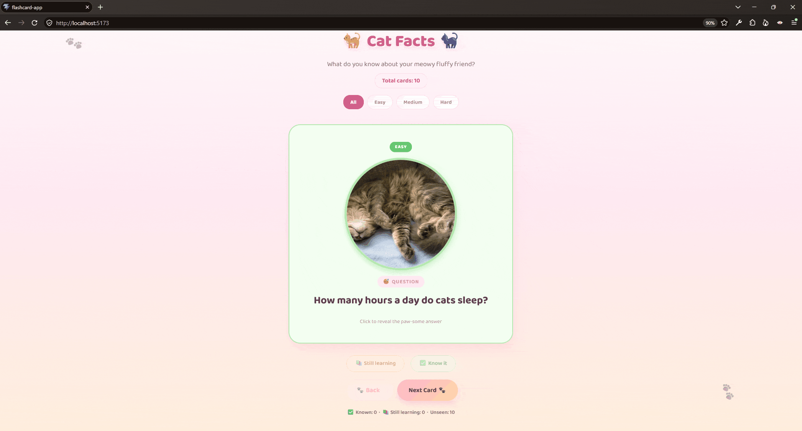

# Web Development Project 2 - *Cat Facts*

Submitted by: **Scarlet Ceballos**

This web app: **Test your knowledge about cats and keep track of what you do or don't know!**

Time spent: **9** hours spent in total

## Required Features

The following **required** functionality is completed:

- [x] **The app displays the title of the card set, a short description, and the total number of cards**
  - [x] Title of card set is displayed 
  - [x] A short description of the card set is displayed 
  - [x] A list of card pairs is created
  - [x] The total number of cards in the set is displayed 
  - [x] Card set is represented as a list of card pairs (an array of dictionaries where each dictionary contains the question and answer is perfectly fine)
- [x] **A single card at a time is displayed**
  - [x] Only one half of the information pair is displayed at a time
- [x] **Clicking on the card flips the card over, showing the corresponding component of the information pair**
  - [x] Clicking on a card flips it over, showing the back with corresponding information 
  - [x] Clicking on a flipped card again flips it back, showing the front
- [x] **Clicking on the next button displays a random new card**

The following **optional** features are implemented:

- [x] Cards contain images in addition to or in place of text
  - [x] Some or all cards have images in place of or in addition to text
- [x] Cards have different visual styles such as color based on their category
  - Example categories you can use:
    - Difficulty: Easy/medium/hard
    - Subject: Biology/Chemistry/Physics/Earth science

The following **additional** features are implemented:

[x] Difficulty Filter
[x] Keyboard shortcuts (right/left arrow for next/back, space/enter to flip)
[x] buttons enabled once a card is flipped and records a status (known/still learning/unseen), shows a running score at the bottom

## Video Walkthrough

Here's a walkthrough of implemented required features:

<!-- Replace this with whatever GIF tool you used! -->
GIF created with [N-Studio](https://nicke.tech/n-studio) for Windows

## Images Used: 
- https://commons.wikimedia.org/wiki/File:Cat_loves_sweets.jpg
- https://pixnio.com/free-images/2017/07/06/2017-07-06-07-22-29.jpg
- https://upload.wikimedia.org/wikipedia/commons/5/52/Cats_in_aoshima_island_1.JPG
- https://upload.wikimedia.org/wikipedia/commons/3/3d/Scottish-Fold-Cat.jpg
- https://commons.wikimedia.org/wiki/File:Black_cat_sniffing_a_flower.jpg
- https://picryl.com/media/cat-kitten-red-mackerel-tabby-animals-5c9ad9
- https://www.flickr.com/photos/helenzhang/3471300822
- https://commons.wikimedia.org/wiki/File:Red_Kitten_01.jpg
- https://pxhere.com/en/photo/995320
- https://www.flickr.com/photos/48282656@N00/8590886161

## Notes

- Getting the right face to show in the front/back layer structure for the 3D card flip was always something I had difficulty getting working and timing it so it clicks mid-animation and not breaking it's state.
- Chaining the swipe-out to then card change and then the swipe in animation with setTimeout while blocking clicks during the transtion
- Because there needed to be randomness, adding a back button would mean keeping track of history so back can replay the previous card instead of another random one
- When a filter is on, "random" would need to mean random within the filtered subset and switching filters mid-session would need to reset the valid card without breaking the flip/animation state

## License

    Copyright [2026] [Scarlet Ceballos]

    Licensed under the Apache License, Version 2.0 (the "License");
    you may not use this file except in compliance with the License.
    You may obtain a copy of the License at

        http://www.apache.org/licenses/LICENSE-2.0

    Unless required by applicable law or agreed to in writing, software
    distributed under the License is distributed on an "AS IS" BASIS,
    WITHOUT WARRANTIES OR CONDITIONS OF ANY KIND, either express or implied.
    See the License for the specific language governing permissions and
    limitations under the License.
